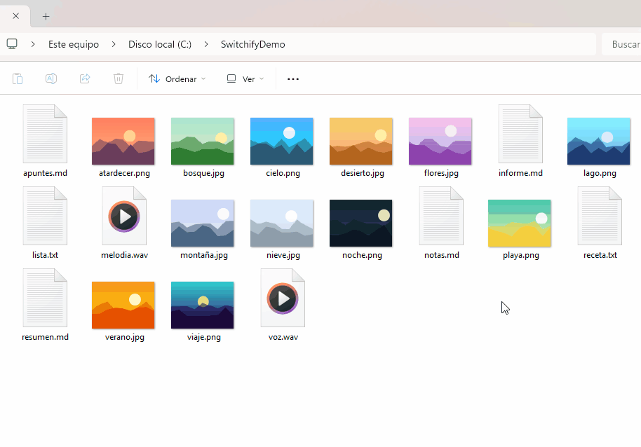

<h1>
  
  Switchify
</h1>

**English** · [Español](README.es.md)

Convert files on Windows from a circular menu. Drag a file, press **Shift**, and drop it on the format you want — or just hover over a file and press Shift. The result is saved next to the original, which is never overwritten.

Switchify is a single `.exe` that lives in the system tray. It uses only what Windows already includes: no extra programs, runtimes or browsers needed.

<p align="center">
  
</p>

> The interface is currently in Spanish.

## How it works

There are four ways to open the ring:

| Gesture | What happens |
|---|---|
| **Drag a file + Shift** | While dragging one or more files, press Shift. The ring appears under the cursor: drop the files on an option. |
| **Hold Shift over a file** | Keep the mouse still over a file and hold Shift. Move to an option and release Shift to run it. |
| **Tap Shift over a file** | A quick tap opens the ring and leaves it open: click an option. Esc or a click outside closes it. |
| **Ctrl+Shift+Space** | Opens the ring for the files selected in File Explorer. |

It works in File Explorer and on the Desktop. If the file under the cursor is part of a selection, the ring uses the whole selection.

### What it can do

| Files | Options |
|---|---|
| **Images** (PNG, JPG, BMP, GIF, TIFF, ICO) | Convert between formats, to PDF (several images → one PDF) and to text with OCR. **Tools**: compress, crop, background, adjust, annotate, redact and view/remove metadata. |
| **Documents** (MD, TXT, DOCX, HTML, PDF) | Convert between PDF, DOCX, MD, HTML and TXT. PDF to Word, Markdown or text keeping headings, lists, tables, bold and italics (scanned PDFs go through OCR), or to images (one per page). Plain text is read with its structure too: headings, lists and tables. |
| **Video** (MP4, MOV, MKV, AVI, WMV, WebM, 3GP) | Convert to MP4 or WMV, compress, and extract the audio to MP3, M4A or WAV. |
| **Audio** (MP3, WAV, M4A, AAC, FLAC, WMA) | Convert between MP3, M4A, WAV, FLAC and WMA. |
| **Anything** | Compress to ZIP (or extract a ZIP). Images and documents can also be printed. |

## Installation

Requires **Windows 10 or 11**.

### Download

1. Download `Switchify.exe` from the [latest release](../../releases/latest).
2. Put it in a folder of your choice and open it. Its icon appears in the system tray.

Windows SmartScreen may warn you because the app is not signed: click **More info → Run anyway**.

### Build from source

No SDK needed: it compiles with the C# compiler that ships with Windows (.NET Framework 4).

```powershell
git clone https://github.com/dimacavidv-lgtm/Switchify.git
cd Switchify
powershell -ExecutionPolicy Bypass -File .\build.ps1
```

This creates `Switchify.exe` and installs a copy in `%LOCALAPPDATA%\Programs\Switchify`. Open that copy the first time; running `build.ps1` again updates it (and restarts it if it is open).

### Start with Windows

Right-click the tray icon and check **Iniciar con Windows** (Start with Windows). It creates a scheduled task that opens Switchify when you sign in.

### Uninstall

Uncheck **Iniciar con Windows**, choose **Salir** (Exit) from the tray menu, and delete `Switchify.exe` (or the `%LOCALAPPDATA%\Programs\Switchify` folder).

## Limitations

To stay free of external dependencies, Switchify cannot convert **to** WebM, MKV, GIF (video) or OGG, nor read OGG/Opus files.

## Contributing

Suggestions and pull requests are welcome. See [CONTRIBUTING.md](CONTRIBUTING.md).

## License

[MIT](LICENSE) © dimacavidv-lgtm
